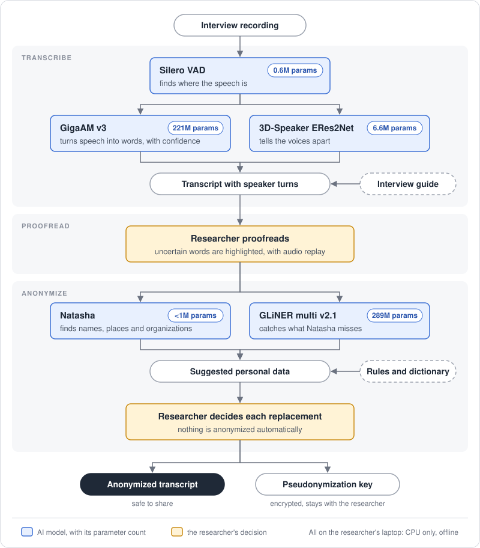
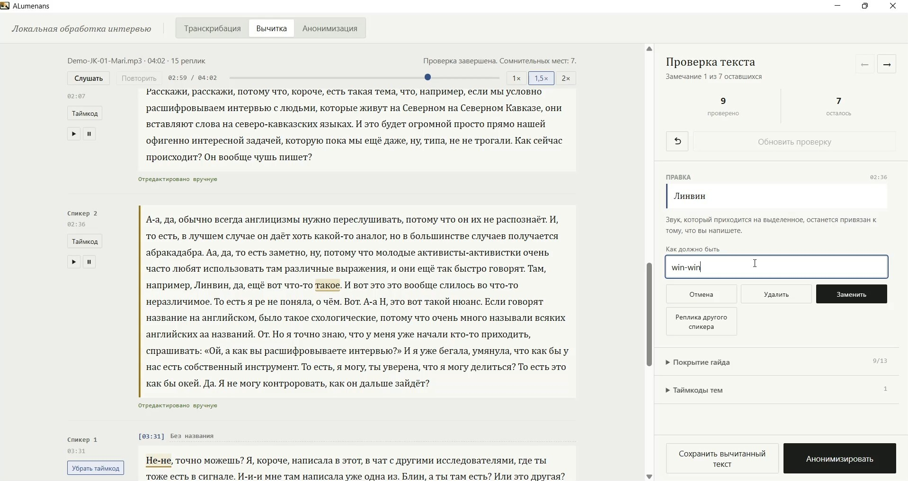
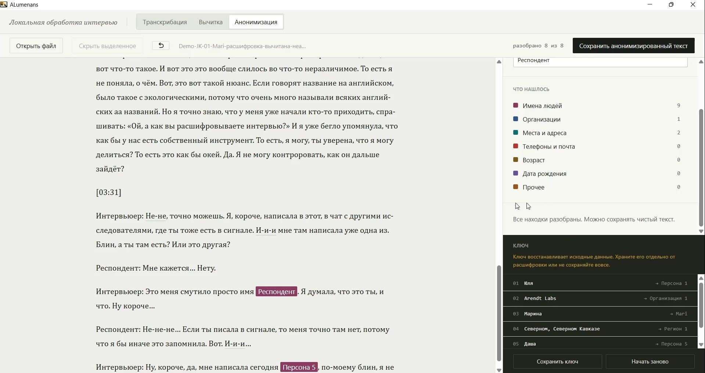

# ALumenans

ALumenans is a free, entirely offline tool that takes a sensitive interview
from recording to a transcript that is safe to share, all on the
researcher's own laptop.

It was built by and for social researchers and human-rights defenders who
interview people at risk: people who speak about persecution, torture and
activism under authoritarian rule. For them a leaked recording or a name
left in a transcript can put the respondent in danger.

## Why ALumenans

- **Private.** Recordings and transcripts never leave the laptop. The only
  network use is a one-time download of the models on first launch. The
  project database and the pseudonymization key (the mapping from each
  pseudonym back to the real name or detail it replaced) are encrypted on
  disk.
- **Small.** Five small open models do the work, and all of them run on an
  ordinary laptop CPU. There is no subscription, no GPU and no company in
  the loop.
- **The researcher decides.** We don't expect small models to produce a
  perfect transcript or to anonymize it on their own. The whole tool is
  designed to make their output easy to inspect and correct: the models
  propose, and the researcher approves every replacement.
- **Errors you can see.** Generative speech models such as Whisper can
  invent a fluent sentence that nobody said. Our transcriber has a simpler
  architecture: it can mishear a word, but the result looks wrong, and the
  app highlights the words it was unsure about.
- **Made for spoken Russian.** Off-the-shelf detectors of personal data are
  trained on written text and struggle with spontaneous speech, and Russian
  grammar makes replacement harder: a pseudonym has to take the case of the
  word it replaces. ALumenans handles both.

## How it works

<p align="center">
  
</p>

A chain of small, specialized models finds the speech, transcribes it,
tells the speakers apart and detects personal data. Between the models sit
two steps that belong to the researcher: proofreading the transcript and
deciding what to anonymize. The interview guide, which the researcher
already has, helps along the way: it tells the interviewer from the
respondent and supplies the study's own vocabulary.

## What working with it looks like

**Proofreading.** The app marks the places where the speech model was
unsure. The researcher steps through them one by one, replays the audio
for each and fixes the text. A misheard ordinary word only hurts the
quality of the transcript, but a misheard name can slip past anonymization,
so this step comes first.



**Anonymization.** The app highlights the names, organizations, places,
contacts and dates it found. The researcher decides what happens to each:
replace it with a pseudonym, keep it, or hide it. Pseudonyms are inflected
to fit the sentence. The pseudonymization key is saved separately,
encrypted, or not saved at all.



Finished transcripts are exported as `.txt` or `.docx`.

## Status

ALumenans works today for Russian-language recordings, with the interface
in Russian or English. It runs on Windows and on macOS 14+ (Apple Silicon).

Next on the roadmap:

- an independent security audit, with the report published;
- a personal-data detector fine-tuned on spoken interviews, to cut false
  positives;
- anonymization rules that research communities define and share
  themselves;
- more recording languages, starting with Kazakh.

## Credits

The public repository was created with a fresh Git history, so earlier contributions are not reflected in the commit log.
We would like to acknowledge the following people for their contributions to ALumenans before its public release:

- Julia Kuzevanova ([@nelepelniza](https://github.com/nelepelniza)) conceived ALumenans, designed its user experience, and developed its original implementation.
She introduced the tool to research and human-rights organizations, grew its initial user community,
and served as its sole maintainer until the project expanded to a larger team.
- Inna Amogolonova ([@innaamogolonova](https://github.com/innaamogolonova)) conducted a thorough review of the codebase and prepared it for public release.
- Aleksandar Milicevic ([@aleksandarmilicevic](https://github.com/aleksandarmilicevic)) set up the build and CI infrastructure,
reorganized the codebase, added English localization, and implemented encryption for intermediate data.

---

## Developer Guide

- [Quick start](#quick-start)
- [Running](#running)
- [Testing](#testing)
- [Building](#building)
- [CI](#ci)
- [Architecture](#architecture)
- [Repository layout](#repository-layout)
- [Conventions](#conventions)
- [License](#license)

## Quick start

You need [uv](https://docs.astral.sh/uv/) and `make`. `uv` downloads Python
3.13 itself if you don't have it.

```bash
make install        # .venv with the package (editable) + dev deps
make test           # full test suite
make run            # launch the app
make help           # list all targets
```

On Linux:

- Use `make install-cpu` to get the CPU-only torch build, which is much
  smaller.
- Run `make linux-gui` before `make run`. It adds Qt, which pywebview needs
  to open a window.

Without make:

```bash
uv venv --python 3.13 .venv
uv pip install --python .venv/bin/python -e '.[dev]'
.venv/bin/python -m alumenans
```

Plain `pip install -e '.[dev]'` in any Python 3.13 environment works too.

## Running

| Command | What it does |
|---|---|
| `make run` | Launch the app. The first launch downloads the models. |
| `make self-test` | Check that the install works, with no window and no models. CI runs this on the built apps. |
| `make startup-check` | Diagnose a slow or failing launch. |
| `python -m alumenans.transcription.worker transcribe rec.m4a --output result.json --speakers 2` | Transcribe without the UI. |
| `python tools/evaluate.py --reference .golden/<ref> --result result.json` | Score a transcript against a reference: word error rate (WER), speaker labels, anonymization. |

**Models.** The first launch downloads:

- GigaAM v3 (`gigaam-v3-e2e-ctc`) for speech recognition;
- a 3D-Speaker ERes2Net embedding model for diarization;
- GLiNER (`urchade/gliner_multi-v2.1`) for named entities.

They go to `models/` next to the package when that folder is writable,
otherwise to a per-user folder (`paths.models_home()`).

**State.** The app keeps a few small files in `INSTALL_ROOT`: `.installed`,
`.startup.log`, `.last-folder` and `.researcher`. In a checkout that folder
is `src/`. Set `ALUMENANS_HOME` to use another one. When a launch fails, the
stack goes to `startup_stack.txt` in the same folder, because the app runs
under `pythonw` with no console.

On Windows, `packaging/windows/dev/run.bat`, `check-startup.bat` and
`diagnose-hang.bat` do the same from a checkout.

## Testing

```bash
make test                                   # everything (~390 tests, a few seconds)
make test T=tests.test_proofreading         # one module
make test T=tests.test_proofreading.SuggestionTests.test_low_acoustic_confidence_becomes_a_review_marker
make pytest                                 # same suite under pytest
```

The tests are plain `unittest`. pytest runs them as well, and `pyproject.toml`
sets `pythonpath = src`. No test needs the models or the network.

Some suites test things you might not expect to have tests:

- **`test_ui_contract.py`** and the `test_anonymization_*`, `test_proof_*`
  and `test_speaker_*` suites assert exact JS snippets and labels in
  `anonymizer.html`. Change a UI string or handler and the test must change
  with it.
- **`test_packaging.py`** checks four things:
  - every third-party import is pinned in `pyproject.toml`;
  - every entry in `REQUIRED_MODULES` is declared there;
  - the version is the same in `ALumenans.iss`, `pyproject.toml` and
    `alumenans/__init__.py`;
  - the Windows installer ships the whole package and installs and
    import-checks the dependencies.
- **`test_mac_build.py`** tests the Mac bundle builder without building
  anything.

## Building

Both builds copy the whole `src/alumenans` tree and start the app with
`python -m alumenans`, so there is no per-file list to maintain. The Python
runtime comes from
[python-build-standalone](https://github.com/astral-sh/python-build-standalone).

### Windows installer

Build it on Windows. It needs [Inno Setup 6](https://jrsoftware.org/isinfo.php).

```powershell
python packaging\windows\fetch-runtime.py          # downloads the runtime into packaging\windows\python-runtime\
powershell -File packaging\windows\build-installer.ps1
```

The script:

1. finds `ISCC.exe`. It looks at `$env:ISCC` first, then PATH, Program
   Files and LOCALAPPDATA;
2. installs the `pyproject.toml` dependencies into the bundled runtime, with
   that runtime's own pip;
3. imports every required module, which catches a missing DLL;
4. compiles `packaging/windows/output/ALumenans-Setup-<version>.exe`.

### macOS app

The Mac app is built on Windows too, and it needs `uv` on PATH:

```bash
python packaging/macos/build-mac.py
```

The script downloads the macOS runtime into `packaging/macos/runtime-cache/`.
It then cross-installs the dependencies for `aarch64-apple-darwin` / macOS 14
with uv. uv is used rather than `pip --platform` because pip would evaluate
`sys_platform` markers for the build machine and drop pyobjc.

Before zipping the `.app`, the script rejects any native code that isn't
Mach-O, which would mean an extension got compiled for the build machine. On
the Mac, unpack the zip with `ditto` (or Finder) so the executable bits
survive. `packaging/macos/HOW-TO-RUN.txt` is what end users read.

### Versioning

The version is defined in `packaging/windows/ALumenans.iss`
(`#define AppVersion`). It must match `pyproject.toml` and
`src/alumenans/__init__.py`, and `test_packaging.py` checks that it does.

## CI

`.github/workflows/ci.yml` runs on every pull request and every push to
`main`. It has four jobs:

| Job | Runner | Steps |
|---|---|---|
| `test` | Ubuntu | Test suite, then `make self-test` |
| `windows` | Windows | Build the installer, install it silently, check the Start-menu shortcut, run `--self-test` with the installed `python.exe` and `pythonw.exe` |
| `macos-build` | Windows | Build the Mac app on Windows, as is done for releases |
| `macos-test` | macos-15 (arm64) | Unpack with `ditto`, then run `Contents/MacOS/ALumenans --self-test` through the real launcher |

The checks live in `src/alumenans/self_test.py`. When something breaks only
in installed builds, add a check there.

## Architecture

```
┌──────────────────────── app process (python -m alumenans) ───────────────────────┐
│                                                                                  │
│  pywebview window ── shows ──▶ resources/anonymizer.html  (the entire UI)        │
│        │                              │                                          │
│        │ window.pywebview.api         │ fetch() to 127.0.0.1                     │
│        ▼                              ▼                                          │
│     AppApi (stateful)           Handler on ThreadingHTTPServer (stateless)       │
│     media, jobs, projects,      /analyze /proofread /inflect /known-words        │
│     study, export               /guide-report /warmup /health, audio ranges      │
│        │                              │                                          │
│        │                              └─▶ anonymization: GLiNER, Natasha,        │
│        │                                  pymorphy3, dictionary, heuristics      │
│        ├─▶ storage/ (SQLite project and study files, exchange, secret zip)       │
│        └─▶ transcription/service.py ──spawns──┐                                  │
└───────────────────────────────────────────────┼──────────────────────────────────┘
                                                ▼
                     python -m alumenans.transcription.worker
                     onnx-asr (GigaAM) + sherpa-onnx (diarization)
                     progress as JSON lines on stdout, result to a file
```

### Shell: `app.py`, `launch.py`, `server.py`, `api.py`

`app.py` is the entry point; `launch.py` prepares the start (build check, model
download, setup window); `server.py` holds the HTTP `Handler`; `api.py` holds
`AppApi`.

`main()` starts a `ThreadingHTTPServer` on 127.0.0.1 and a pywebview window
that shows `resources/anonymizer.html`. That one HTML file holds the whole
UI: the transcription, proofreading and anonymization tabs. It reaches
Python in two ways:

- **HTTP endpoints on `Handler`**, for stateless text analysis and for
  serving audio with byte ranges.
- **`AppApi`**, exposed as `window.pywebview.api`, for stateful operations:
  picking media, transcription jobs, project and study files, and saving
  `.txt`, `.docx` and encrypted pseudonymization-key archives.

**Launch sequence:**

1. A separate setup-window process shows progress while `prepare_launch()`
   downloads models.
2. The setup window closes when the UI calls `mark_interface_ready`.
3. If a module from `dependencies.REQUIRED_MODULES` is missing, launch
   stops with an "incomplete build" message. Nothing gets installed at
   runtime.

### Paths: `paths.py`

- `RESOURCES`: the read-only files that ship with the package.
- `INSTALL_ROOT`: the folder that contains the package. That is `{app}`
  when installed, `src/` in a checkout, or `ALUMENANS_HOME` if set. Mutable
  state lives here.
- `state_file()`: returns the path of a state file. On first read it
  renames the file from its old Russian name, used before 0.3.0.
- `child_environment()`: child processes start as modules (`-m alumenans`,
  `-m alumenans.transcription.worker`), and this puts `INSTALL_ROOT` on
  their `PYTHONPATH`. Never run a file inside the package directly, because
  its imports would break.

### Transcription: `transcription/`

Transcription runs in its own process. That keeps its memory free before
the anonymization models (GLiNER, Natasha) load in the app.

- `service.TranscriptionManager` spawns `worker`. The worker reports
  progress as JSON lines on stdout and writes the large result to a file.
- `core.py` holds the pure logic that needs no models: chunking,
  validation, sentence endings and turn boundaries. Most transcription
  tests target it.

### Anonymization: `detection.spans.find_spans`

`find_spans` merges entity spans from several sources:

- the curated dictionary `resources/names-and-organizations.txt`, which
  lists public names that stay unmasked;
- GLiNER and Natasha NER;
- vocative detection (`vocative.py`);
- self-introductions (`introduction.py`);
- place classification (`places.py`).

It then filters out false positives: speech fillers, capitalized verbs and
the study's own subject terms. Pseudonyms are inflected to match the case
of the word they replace, using Natasha morphology and pymorphy3.

### Persistence: `storage/`

All of it uses SQLite and the standard library only.

- **`project_store.py`**: one project file per interview. It lives in the
  study folder, not next to the audio, so it survives deleting the
  recording. Turn IDs come from the audio rather than the text, so
  decisions stay attached when the text is edited.
- **`study_store.py`**: data shared across a series of interviews. That
  covers the guide, the study documents and the explicit "do not
  anonymize" list. The app may suggest entries for that list but must
  never add any silently.
- **`exchange.py`**: the file-based boundary with the shared environment. A
  study file comes in and anonymized exports go out. It never makes network
  calls.
- **`secret_zip.py`**: a WinZip-compatible AES-256 zip for the
  pseudonymization key, written with the standard library only.

### Interview guide: `guide/`

- `parse.py`: turns the guide document into structured questions and
  branches. It doesn't trust question numbers, and it keeps the text read
  aloud apart from prompts meant for the interviewer.
- `align.py`: matches the transcript against the guide and skips branches
  that weren't taken.
- `report.py`: reports how much of the guide the interview covered.
- `speakers.py`: uses the guide to tell the interviewer from the
  respondent.

## Repository layout

```
src/alumenans/            the package
  app.py                  entry point: starts the server and the pywebview window
  launch.py               build check, model download, setup window
  server.py               HTTP Handler: the screen, audio, text analysis
  api.py                  AppApi: what the window can ask of Python
  current_audio.py        the recording that is open now
  detection/              personal-data search: rules, public names, models, filters
  paths.py                install root, resources, models folder, child env
  dependencies.py         modules a build must contain
  self_test.py            --self-test checks
  transcription/          worker process, its manager, model-free core logic
  storage/                SQLite project/study stores, exchange, encrypted zip
  guide/                  interview-guide parsing, alignment, coverage, speakers
  resources/              anonymizer.html (UI), names dictionary, icons
tests/                    unittest suite
tools/                    evaluate.py (metrics), startup_check.py (diagnostics)
packaging/
  dependencies.py         pyproject deps → requirements for the builds
  standalone_python.py    python-build-standalone download helper
  windows/                Inno Setup script, build-installer.ps1, fetch-runtime.py
  windows/dev/            .bat launchers for a checkout
  macos/                  build-mac.py, launcher, Info.plist, icon
.github/workflows/ci.yml  CI
```

## Conventions

- **Language.** File names, identifiers, comments, docstrings and
  developer output are in English. Russian is kept in two places:
  - text an end user reads, in the UI catalogs (see "Interface language"
    below), the installer texts and the exported file names;
  - language data the app processes: GLiNER prompts, word lists, regexes,
    the names dictionary, and Russian sample text in tests.
- **Interface language.** Every string a person reads goes through a
  catalog, never a literal:
  - Python: `t("key", **params)` from `alumenans.i18n`, with the text in
    `alumenans/locales/ru.py` and `en.py`;
  - the screen: `tr("key", {params})` / `trn("key", n)` in JS, and
    `data-i18n="key"` (or `data-i18n-title`, `-placeholder`, `-aria-label`)
    in the markup, with the text in `const I18N` in `resources/i18n.js`,
    which `anonymizer.html` loads before its own script.

  Add each new key to every language; `tests/test_i18n.py` checks that the
  keys and placeholders match. What goes into the user's documents follows
  the recording language, not the UI: pseudonyms («Персона 1»), speaker
  labels («Спикер 2»), exported file names and the pseudonymization key
  file stay Russian.
  The choice is stored in `.ui-language`, and child processes get it in
  `ALUMENANS_UI_LANGUAGE`.
- **Imports are absolute:** `from alumenans.storage.project_store import …`.
  Mock targets use the full dotted path, e.g.
  `patch("alumenans.launch.subprocess.run")`.
- **Dependencies:**
  - Every new third-party import gets an exact pin in `pyproject.toml`.
  - If the app can't start without it, also add it to `REQUIRED_MODULES` in
    `dependencies.py`.
  - Prefer the standard library. Every dependency makes the installer
    bigger, and it needs macOS arm64 wheels.
  - When bumping torch, check which macOS version its wheels require.
    `MACOS_MIN` in `build-mac.py` and `LSMinimumSystemVersion` in
    `Info.plist` must match it.
- **Source-reading tests** locate files through `alumenans.paths.PACKAGE_DIR`
  and `RESOURCES`, not `__file__`.
- **No console output.** The app runs under `pythonw`, with `sys.stdout`
  and `sys.stderr` pointed at devnull. Use the startup log or
  `startup_stack.txt` for diagnostics, never `print`.
- **Windows `.bat` files** keep their commands ASCII-only, because cmd
  breaks on Cyrillic labels and variable names.

## License

ALumenans is licensed under the [GNU GPL, version 3 or later](LICENSE).
The source code is public at https://github.com/hannah-arendt/alumenans.
[THIRD-PARTY-NOTICES.md](THIRD-PARTY-NOTICES.md) lists the bundled
components and their licenses.

Both builds run `packaging/third_party_licenses.py` on the packages they
actually ship. It copies every license text into a `licenses/` folder,
which goes into the installer and the app next to `LICENSE` and the
notices. The build stops if a package has no license text.
